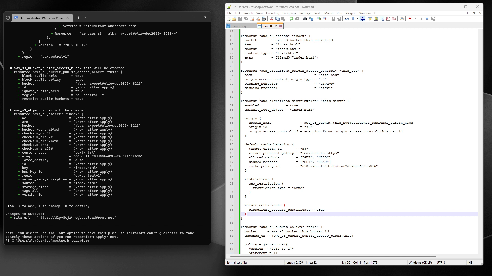
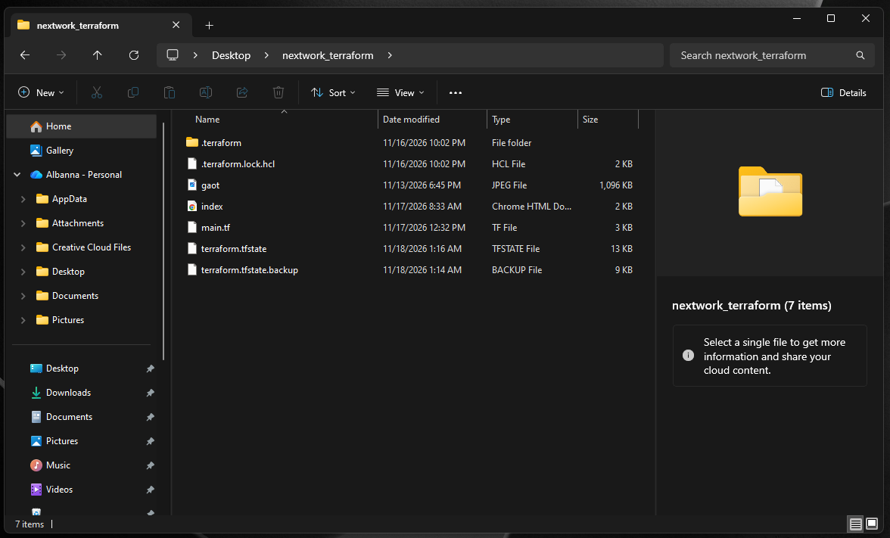
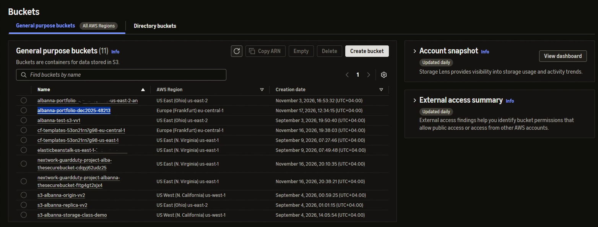
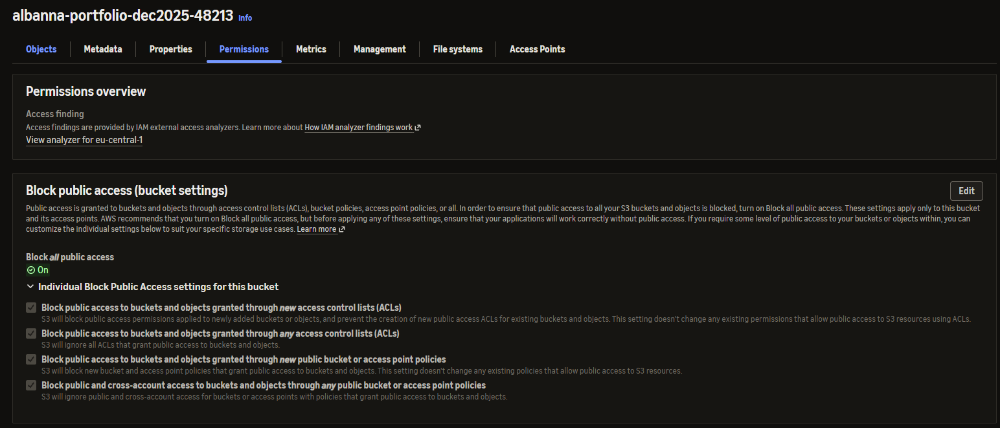
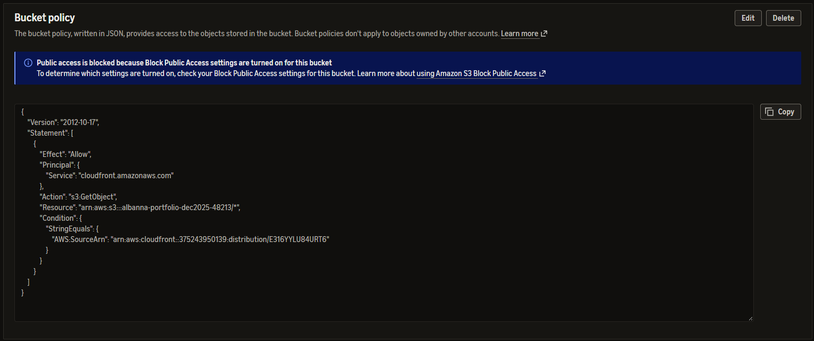
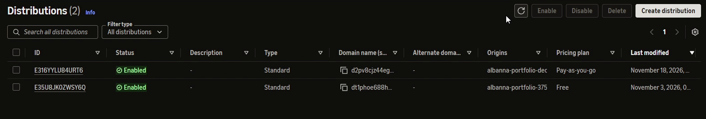
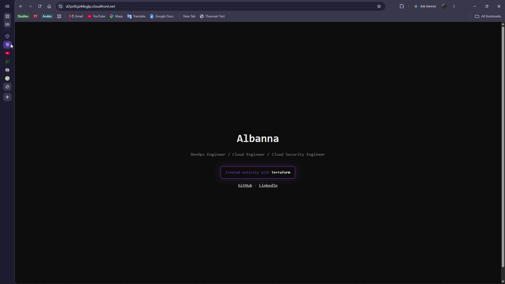

# Static-Website-on-AWS-with-Terraform
Deployed a static website on AWS using **Terraform**

A static website hosted in a private Amazon S3 bucket and served globally through Amazon CloudFront over HTTPS. The bucket is never public. CloudFront reads from it using Origin Access Control (OAC), and the whole setup is defined as code and deployed with Terraform.

## Demo
Video will be posted as soon as possible :)

## Architecture
Browser -> Cloudfront -> Private S3 Bucket

## AWS services used
Amazon S3: Stores the website files (index.html) in a private bucket with Block all public access turned on.  
Amazon CloudFront: Serves the site over HTTPS and caches it at edge locations. HTTP requests are redirected to HTTPS.  
CloudFront Origin Access Control (OAC): Lets CloudFront securely sign requests to the private bucket.  
S3 bucket policy: Allows only my CloudFront distribution to read objects, using an AWS: SourceArn condition

[ Tool used ]  
Terraform: Defines and deploys all of the above from a single main.tf file.

## Screenshots (Description):
S1: terraform plan output (left) next to main.tf (right), showing the resources about to be created and the site_url output.  
<p align="left">
  
</p>

S2: The project folder. Only main.tf, index.html and the lock file are uploaded here. The state files and the .terraform folder stay local because state can contain sensitive details.  
<p align="left">
  
</p>

S3: The S3 console after apply, showing the bucket Terraform created in eu-central-1.  
<p align="left">
  
</p>

S4: The bucket's Permissions tab, showing Block all public access turned on with all four settings checked.  
<p align="left">
  
</p>

S5: The bucket policy, allowing only the CloudFront service to read objects, and only from my distribution (account ID blurred).  
<p align="left">
  
</p>

S6: The CloudFront console, showing the distribution created by Terraform (E316YYLU84URT6) in the Enabled state.  
<p align="left">
  
</p>

S7: The website loading over HTTPS on the CloudFront URL.  
<p align="left">
  
</p>

## How to run
Requires Terraform and AWS credentials configured.
 
```bash
terraform init
terraform plan
terraform apply
```
 
The site_url output is the CloudFront address. To remove everything:
 
```bash
terraform destroy
```

## Key things I've learnt  
- How Terraform resources reference each other (for example, the bucket policy uses the bucket and the distribution), so it knows what to create first.  
- Terraform doesn't set a file's content type automatically, so index.html needs content_type = "text/html" or the browser downloads it instead of showing it.  
- CloudFront takes a few minutes to deploy, and a 403 error usually means the file or the bucket policy is missing.  

## Possible Improvement
- Move the distribution onto CloudFront's free flat-rate plan, so usage is capped with no overage charges (it currently uses pay-as-you-go pricing).
- Add a custom domain with Route 53 and an ACM certificate.
- Store the Terraform state remotely in S3 and deploy automatically with GitHub Actions.
